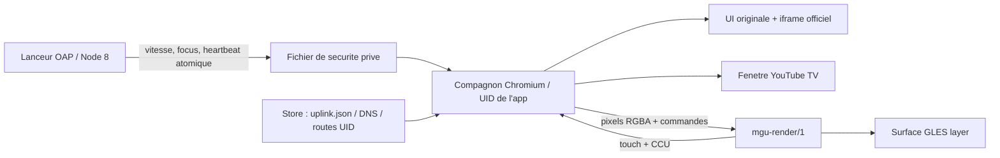

# Architecture et comparaison

## Decouverte de la plateforme

Sources consultees le 12 novembre 2026 :

- [idrive7-apps](https://github.com/cauliflowermossgrape/idrive7-apps),
  commit `58cb47d03015a55abd0d4ec2cefd9cb23a643551` : apps Node 8/OAP,
  RHMI et commandes GLES ; le build fournit uniquement ID7.
- [mgu-render/1](https://github.com/cauliflowermossgrape/idrive7-apps/blob/58cb47d03015a55abd0d4ec2cefd9cb23a643551/kit/renderd/PROTOCOL.md) :
  surfaces layer/embed, pixmaps, routage tactile/rotatif, foreground gate,
  option de video I420 en memoire partagee.
- [mgu-store](https://github.com/robertnisipeanu/mgu-store/blob/407f13e2091a028f7855568c51ba36f10dfab40d/docs/PUBLISHING.md) :
  `mguInternet`, SDK extrait localement, identites globales, outils natifs separes.
- [mgu-uplink](https://github.com/robertnisipeanu/mgu-store/blob/407f13e2091a028f7855568c51ba36f10dfab40d/native/mgu-uplink/README.md) :
  routes par UID, resolver systeme inchange, DNS fournis dans `uplink.json`.
- [Lecteur YouTube](https://developers.google.com/youtube/player_parameters)
  et [Data API search.list](https://developers.google.com/youtube/v3/docs/search/list).

Le SDK BMW et le renderer ne fournissent pas un WebView general documente.
Un PNG rafraichi ne suffit pas a fournir une experience video correcte.
Le support I420 du renderer est un transport de frames, pas un client
YouTube, une pile audio ni un navigateur.

## Choix effectue

Un runtime Chromium partage evite deux piles de decodage differentes.

1. **UI originale** : recherche via l'API officielle, rendu des resultats
   sans HTML injecte, lecteur officiel `youtube-nocookie.com/embed`.
   Pas de reconstruction d'URLs de streams ni de recuperation de videos.
   Une URL directe reste possible sans cle API.
2. **Browser encapsule** : fenetre separee chargeant `youtube.com/tv`
   en navigation principale. Pas d'iframe du site TV (CSP / X-Frame-Options),
   pas d'interface de connexion imitee. Chromium decide des codecs disponibles,
   YouTube decide du support du navigateur et de la connexion.

Un essai sans mocks le 12 novembre 2026 a obtenu le titre `YouTube TV`,
mais le corps de page annonce une redirection vers `youtube.com` et
recommande l'application officielle. Cela confirme l'accessibilite HTTPS,
**pas** la disponibilite de l'interface TV dans Electron. Aucun
user-agent de televiseur ni contournement de ce refus n'est ajoute.

Le moteur actuel est Electron. Le composant `oussem-browser` fournit
l'executable recent et un userland prive : son loader et ses bibliotheques
sont sous `/var/opt/oussem-browser/current/lib`. Les ELF ont un interpreter
et un RPATH explicites vers ce composant, pas vers la glibc du firmware.
Xvfb est recompile avec des chemins XKB prives, sans ecoute TCP, authentifie
par un cookie aleatoire par session. Le MGU recoit ses frames par le renderer,
pas par un serveur X installe a la place du compositor du vehicule.

Le helper sandbox officiel de Chromium est root-owned mode 4755 dans
l'outil ; les chemins de ses dependances restent root-owned. Le navigateur
et Xvfb sont lances sous l'UID OAP. Aucun `--no-sandbox`. Le test glibc 2.27
demarre l'ensemble depuis Node 8, verifie des frames et le filtre seccomp
du processus renderer. Le noyau du conteneur de test n'est pas celui du MGU.

## Chemin voiture experimental

Le pont convertit BGRA vers RGBA, conserve seulement la frame recente,
refuse de remplir une socket deja congestionnee et plafonne l'envoi a
20 images/s via le renderer. Resolution logique de 1280 px de large,
ratio issu de la zone disponible. Il s'agit de **readback Chromium puis
upload GPU**, pas de zero-copy video ni d'un renderer video a 60 fps.
Ce cout doit etre mesure sur l'Atom du MGU avant toute recommandation.
L'option I420 existe en amont mais n'est pas implementee ici.

Le client utilise la couche layer : le lanceur OAP est un menu stock,
pas le template optionnel necessaire a embed. Le mode normal garde une
marge dans la zone `appArea` ; le plein ecran utilise toute cette zone.
BACK/HOME et les protections du HMI restent prioritaires.
Les notifications de perte de premier plan suspendent le runtime.

Le son passe par Chromium et son backend systeme. **Aucune integration
avec l'audio-focus BMW n'est encore validee ou revendiquee.**

## Reseau et secrets

Sur bureau : resolver et connexion du PC.
Sur MGU : proxy CONNECT local ephemere, reserve aux domaines YouTube/Google,
resolution DNS par les serveurs du bail du Store, TLS de bout en bout
verifie par Chromium. L'API utilise HTTPS avec le meme resolver du bail.
Pas de DNS public code en dur, pas de modification de `resolv.conf`,
pas de desactivation de TLS, pas de serveur accessible sur le LAN.
IPv4 est actuellement requis pour les destinations du proxy.

La cle Data API reste dans le processus principal, jamais dans le preload,
les resultats IPC ou le depot. Les cookies du site TV restent dans le
profil Chromium local ; ils ne sont pas transmis au Store.
Le site distant n'a aucun preload, acces Node, IPC privilegie ni droit
d'ouvrir des fenetres ou de telecharger des fichiers.

## Validation garage sans dependance a la vitesse

Le lanceur propose deux boutons de session Garage test, pour les essais
sur MGU dans un vehicule stationne. Le runtime doit etre lance avec
`--garage-test` et recevoir `garageTest: true` dans un heartbeat recent.
La politique partagee ignore alors les champs de vitesse, mais pas le focus,
le premier plan du renderer ni le heartbeat. La perte de focus annule la
session dans le lanceur ; aucune preference persistante n'est enregistree.
Le mode normal conserve ses controles de vitesse pour eviter une regression.
Les tests couvrent les deux chemins, notamment le demarrage garage sans
aucun echantillon de vitesse et la terminaison lors d'une perte de focus.

## Etapes restant avant une premiere version voiture

1. Confirmer sur le vehicule le noyau, la politique sandbox et le budget RAM.
2. Installer le compagnon publie via le canal Releases et verifier son
   lancement sous l'UID OAP, ses permissions sockets et son profil.
3. En cas d'echec, conserver le message et les logs avant tout changement
   de strategie ; ne pas desactiver la sandbox.
4. Mesurer CPU/GPU/memoire, navigation, codecs et lecture YouTube reelle.
5. Integrer et tester l'audio-focus et interruptions telephone/camera.
6. Valider les garde-fous sur banc puis vehicule stationne.
7. Ajouter de vraies descriptions HMI ID8 et des tests sur ce materiel
   avant d'annoncer sa prise en charge.
